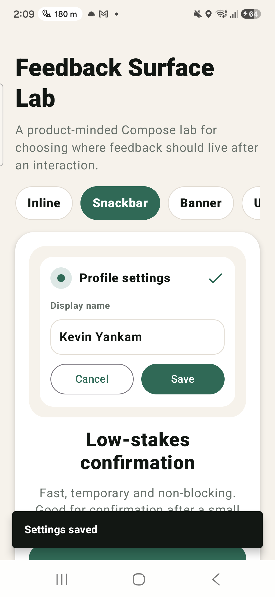

# Feedback Surface Lab

Mini-projet Android/KMP pour explorer les surfaces de feedback dans une UI Compose.

Le but n'est pas de livrer une app complete, mais de comparer ou placer le feedback apres une interaction :

- message inline ;
- snackbar ;
- banner ;
- undo ;
- feedback bloquant.

## Pourquoi ce mini-projet ?

Un feedback n'a pas toujours besoin d'interrompre l'utilisateur. Le bon pattern depend de l'impact :

- l'utilisateur peut-il corriger quelque chose ?
- peut-il continuer sans lire le message ?
- le message concerne-t-il toute la page ?
- faut-il proposer une recuperation immediate ?
- est-ce vraiment assez critique pour bloquer ?

Chaque pattern est interactif pour comparer le niveau de friction, la hierarchie visuelle et la clarte du message.

## Stack

- Kotlin Multiplatform
- Compose Multiplatform
- Material 3
- Android target pret a lancer

## Screenshots

<p align="center">
  
</p>

## Idee de post LinkedIn

> Tous les feedbacks ne meritent pas un dialog.
>
> Dans ce mini-projet Compose/KMP, je compare 5 surfaces : inline, snackbar, banner, undo et blocking feedback.
>
> La question interessante : comment informer sans interrompre inutilement ?

## Run

```bash
./gradlew :composeApp:assembleDebug
```
